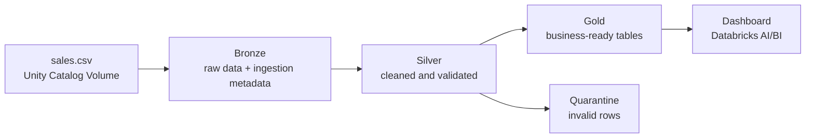
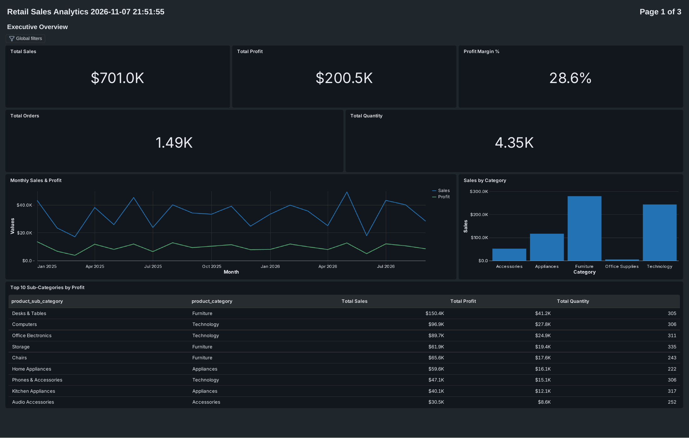
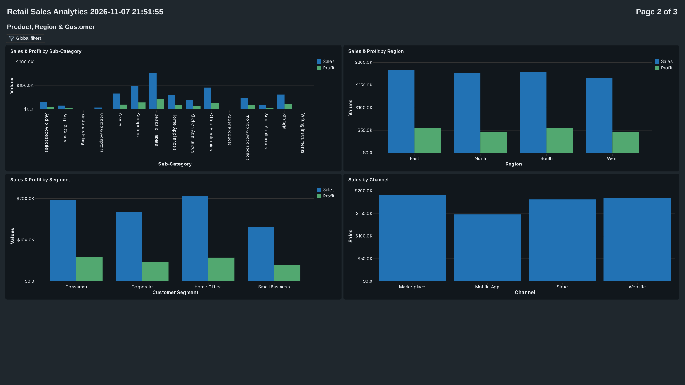
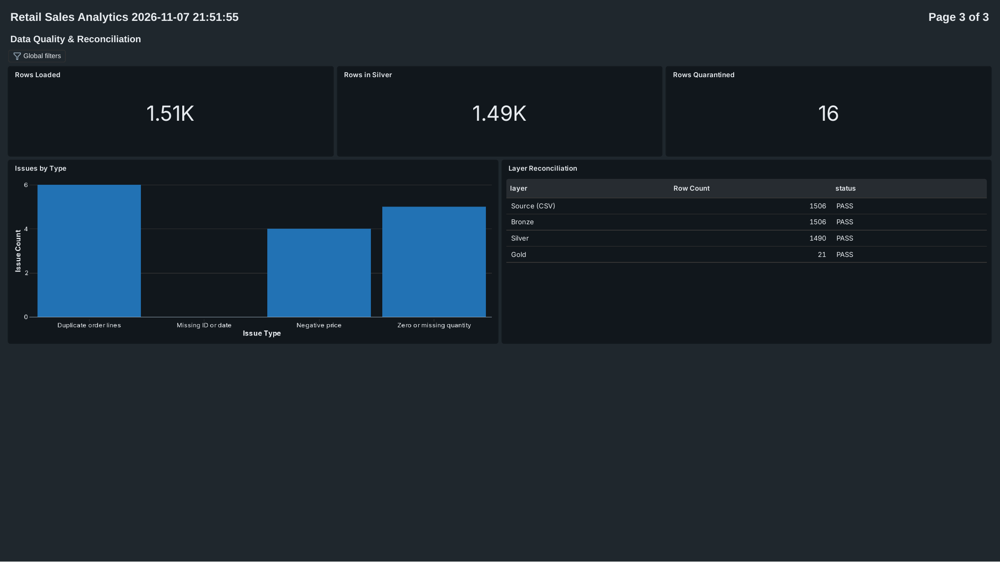

# Retail Sales Medallion Pipeline

A batch data pipeline on **Databricks** that turns a raw retail sales CSV into trusted reporting tables, using the **Medallion architecture** (Bronze, Silver, Gold) and **Lakeflow Spark Declarative Pipelines** with SQL. A Databricks dashboard on top of the Gold layer shows sales performance and data quality.

> **About the data:** this was built as a hands-on case study at Innomatics Research Labs. The dataset is **synthetic** (1,506 rows, 33 columns) and contains intentional quality problems. It is not from a real company.

---

## Project at a glance

| | |
|---|---|
| **Goal** | Replace manual spreadsheet cleanup with a repeatable path from raw sales file to trusted reports |
| **Input** | `sales.csv` in a Unity Catalog Volume |
| **Output** | Gold tables and a 3-page dashboard (sales, products, regions, segments, channels, data quality) |
| **Result** | 1,506 rows loaded, 1,490 kept, 16 quarantined, with reconciliation across layers |
| **Stack** | Databricks, Unity Catalog, Lakeflow Spark Declarative Pipelines (SQL), Delta Lake, Databricks AI/BI Dashboards |

---

## Architecture



| Layer | Purpose | What happens here |
|---|---|---|
| **Bronze** | Keep the source as it arrived | Loads the CSV as-is and adds ingestion metadata, so every value can be traced back to the file |
| **Silver** | Make the data trustworthy | Trims and standardizes text, casts data types, applies quality rules, and separates invalid rows into a quarantine table |
| **Gold** | Answer business questions | Aggregates sales and profit by month, category, sub-category, region, customer segment and channel |

---

## Data quality rules

The raw file has realistic problems. The pipeline flags them and **quarantines** the rows instead of silently deleting or fixing them, so nothing is lost and every decision can be audited.

| Issue | Rows found | Treatment |
|---|---|---|
| Duplicate order lines | 6 | Quarantined (duplicates are checked at the sales-line level, because Order ID alone is not unique) |
| Negative unit price | 4 | Quarantined for investigation |
| Zero or missing quantity | 5 | Quarantined for investigation |
| Missing ID or date | 0 | Quarantined if found |

<!-- TODO before publishing: the issue counts above add up to 15, but the dashboard shows 16 quarantined rows. Check the quarantine logic and fix whichever number is wrong. -->

### Reconciliation

| Layer | Rows | Status |
|---|---|---|
| Source (CSV) | 1,506 | PASS |
| Bronze | 1,506 | PASS |
| Silver | 1,490 | PASS (1,506 - 16 quarantined) |
| Gold | 21 | PASS (aggregated summary) |

---

## Dashboard

The dashboard has three pages and global filters for **Order Date, Category, Region and Segment**.

### 1. Executive overview



| Total Sales | Total Profit | Profit Margin | Total Orders | Total Quantity |
|---|---|---|---|---|
| $701.0K | $200.5K | 28.6% | 1.49K | 4.35K |

### 2. Product, region and customer



### 3. Data quality and reconciliation



---


## What the data shows

- **Furniture and Technology** bring in the most sales of the five categories.
- **Desks & Tables** is the most profitable sub-category ($41.2K profit on $150.4K sales).
- Sales are spread fairly evenly across the **four regions** (East, North, South, West).
- **Mobile App** is the lowest-selling of the four channels.

---

## Repository structure

```text
retail_sales_medallion_pipeline/
├── Root_Retail_Sales_sdp/
│   ├── Bronze/        # raw ingestion
│   ├── Silver/        # cleaning, validation, quarantine
│   └── Gold/          # business aggregations
├── dashboards/        # Databricks dashboard export
├── docs/images/       # dashboard screenshots
└── README.md
```

---

## How to run

**You need:** a Databricks workspace with Unity Catalog, serverless pipelines (or a cluster), and a SQL warehouse for the dashboard.

1. **Clone** the repo into your workspace (Workspace > Create > Git folder):
   `https://github.com/prudhvi108/retail_sales_medallion_pipeline`
2. **Upload the data:** put `sales.csv` in a Unity Catalog Volume, for example `/Volumes/<catalog>/<schema>/<volume>/sales.csv`, and update that path in the Bronze code.
3. **Create the pipeline:** in Jobs & Pipelines, create a Lakeflow Spark Declarative Pipeline that points to the `Bronze`, `Silver` and `Gold` folders, then run it.
4. **Check the results:** confirm the row counts in the reconciliation table above.
5. **Open the dashboard:** import the dashboard from `dashboards/` and connect it to the Gold schema through a SQL warehouse.

---

## Design decisions

- **Keep raw data in Bronze**, so cleaning rules can change without re-fetching the source.
- **Quarantine instead of delete**, so every rejected row is visible and explainable.
- **Never treat Order ID as unique.** One order can contain several product lines, so duplicates are judged at the line level.
- **Reconcile every layer**, so the Gold totals can be traced back to Silver and the source file.

## Limitations and next steps

- Batch only, with a single synthetic file. Daily files would need incremental ingestion (for example Auto Loader).
- No separate customer and product dimension tables yet.
- No alerts on failed data-quality checks.

---

## Author

**Prudhvi Sai Mada**: [GitHub](https://github.com/prudhvi108) | [LinkedIn](https://linkedin.com/in/prudhvi-sai-62324a353)
